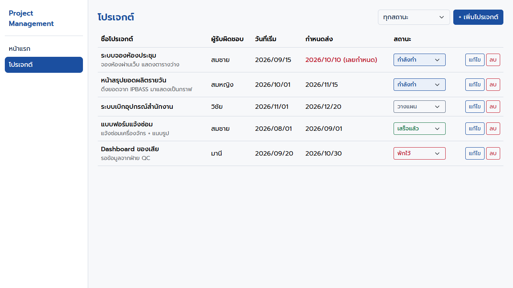
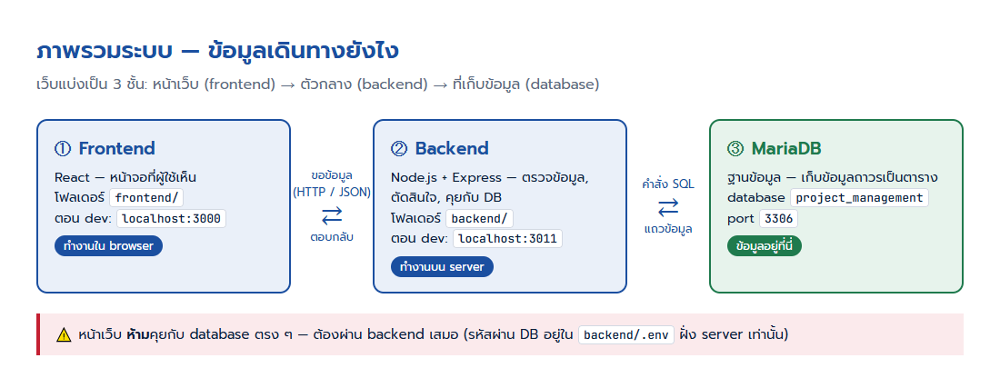
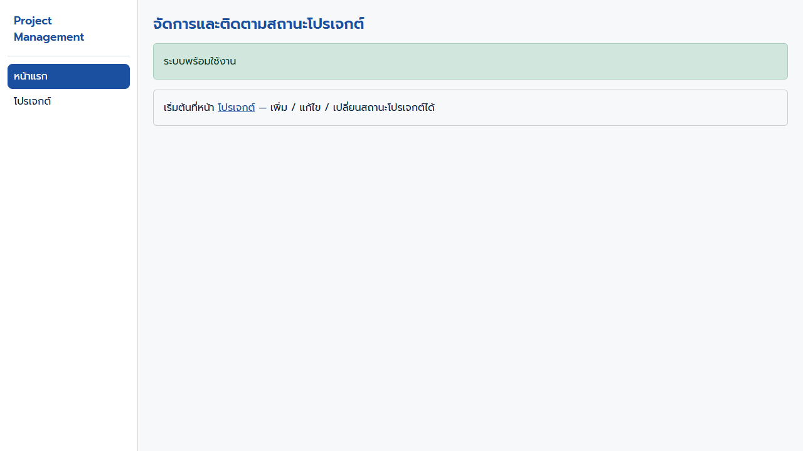
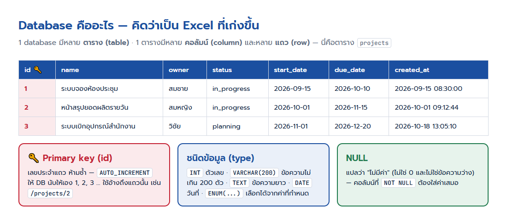
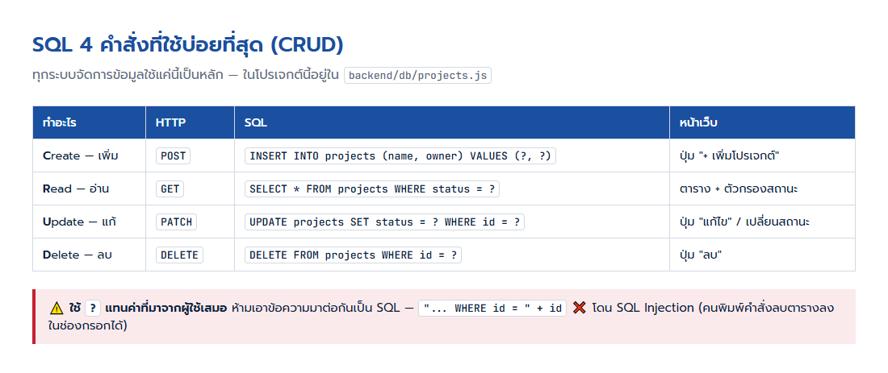
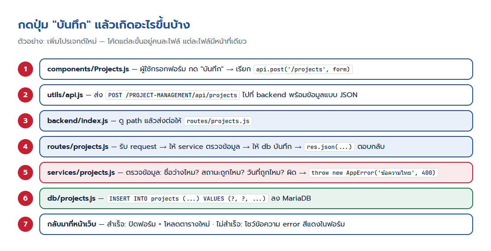
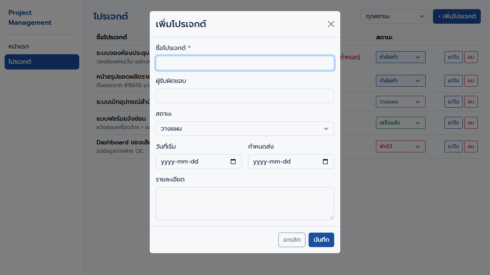
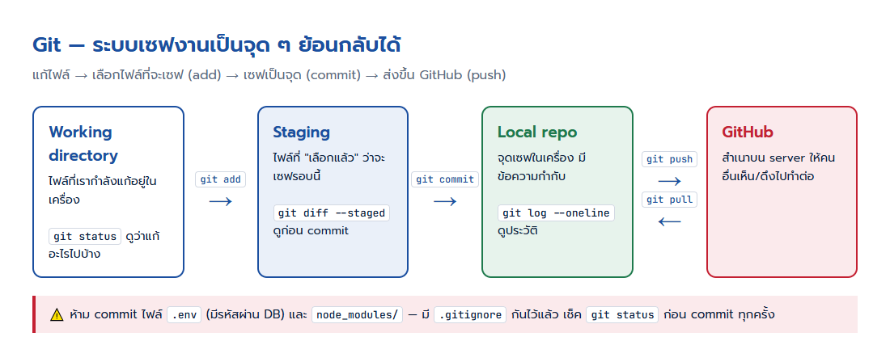
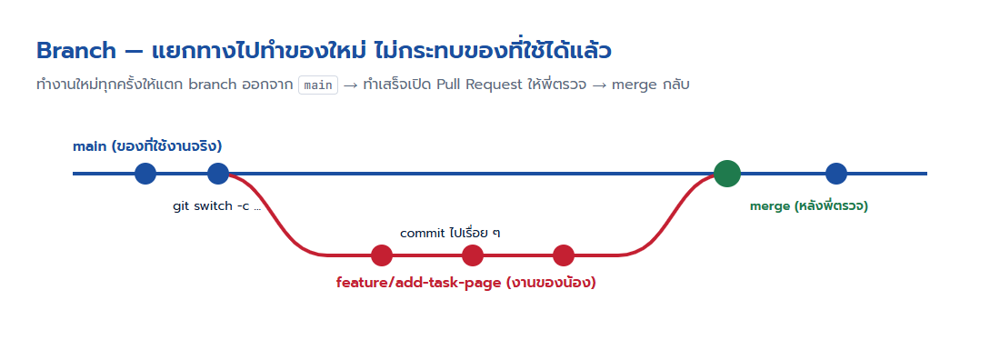

# Project Management — คู่มือสำหรับนักล่องมือใหม่

เว็บสำหรับ **จัดการและติดตามสถานะโปรเจกต์** — ตอนนี้มีหน้า "โปรเจกต์" ให้ดูเป็นตัวอย่างหนึ่งหมวด น้อง ๆ จะต่อยอดเพิ่มหน้าอื่นจากโครงนี้

ถ้ายังไม่เคยทำเว็บมาก่อนก็ไม่เป็นไร ค่อยๆเป็นค่อยๆไปเด้อ



---

## สารบัญ

1. [ภาพรวมระบบ](#1-ภาพรวมระบบ)
2. [เตรียมเครื่อง](#2-เตรียมเครื่อง)
3. [เปิดโปรเจกต์ครั้งแรก](#3-เปิดโปรเจกต์ครั้งแรก)
4. [ไฟล์ไหนทำอะไร](#4-ไฟล์ไหนทำอะไร)
5. [Database เบื้องต้น](#5-database-เบื้องต้น)
6. [กดปุ่มแล้วเกิดอะไรขึ้น](#6-กดปุ่มแล้วเกิดอะไรขึ้น)
7. [ฝึกทำ: เพิ่มหมวด "งานย่อย (tasks)"](#7-ฝึกทำ-เพิ่มหมวด-งานย่อย-tasks)
8. [กฎการเขียนโค้ดของทีม](#8-กฎการเขียนโค้ดของทีม)
9. [Git — ใช้ยังไง](#9-git--ใช้ยังไง)
10. [เจอปัญหา ทำยังไง](#10-เจอปัญหา-ทำยังไง)
11. [API ที่มีอยู่](#11-api-ที่มีอยู่)
12. [Deploy ขึ้น server (สำหรับพี่)](#12-deploy-ขึ้น-server-สำหรับพี่)

---

## 1. ภาพรวมระบบ



| ส่วน | ใช้อะไร | อยู่ที่ |
|---|---|---|
| **Frontend** — หน้าตาเว็บ | React + Bootstrap (react-bootstrap) | `frontend/` |
| **Backend** — ตัวกลาง ตรวจข้อมูล คุยกับ DB | Node.js + Express | `backend/` |
| **Database** — ที่เก็บข้อมูล | MariaDB (ใช้คำสั่งแบบ MySQL) | server ของเมกะ |

ตอน dev จะเปิด **2 หน้าต่าง terminal**: หนึ่งรัน backend (port 3011) อีกหนึ่งรัน frontend (port 3000)

---

## 2. เตรียมเครื่อง

ติดตั้งให้ครบก่อน:

| โปรแกรม | ไว้ทำอะไร | เช็คว่ามีแล้ว |
|---|---|---|
| [Node.js](https://nodejs.org) (LTS, 18 ขึ้นไป) | รัน backend + build frontend | `node -v` |
| [Git](https://git-scm.com) | เก็บประวัติโค้ด / ส่งงาน | `git --version` |
| [VS Code](https://code.visualstudio.com) | เขียนโค้ด | — |
| HeidiSQL หรือ DBeaver | เปิดดูข้อมูลใน database | — |

ขอจากพี่กรๆๆๆ: **ค่าเชื่อมต่อ database** (host, user, password, ชื่อ database) และ **สิทธิ์เข้า repo บน GitHub**

---

## 3. เปิดโปรเจกต์ครั้งแรก

### 3.1 ดึงโค้ดลงเครื่อง

```bash
git clone <url ของ repo ที่พี่ให้>
cd PROJECT_MANAGEMENT
```

### 3.2 ตั้งค่า backend

```bash
cd backend
copy .env.example .env      # Windows (Git Bash / Mac ใช้ cp)
```

เปิดไฟล์ `backend/.env` แล้วเติมค่าที่ได้จากพี่:

```ini
DB_HOST=xxx.xxx.xxx.xxx
DB_USER=xxxx
DB_PASSWORD=xxxx
DB_NAME=project_management
```

> ⚠️ ไฟล์ `.env` มีรหัสผ่าน **ห้ามส่งให้ใคร ห้าม commit ขึ้น git** (มี `.gitignore` กันไว้แล้ว)

```bash
npm install          # ติดตั้ง library (ครั้งแรก / ตอนมีคนเพิ่ม library)
npm run db:apply     # สร้างตารางจาก db/schema.sql (รันซ้ำได้ ไม่ลบข้อมูลเดิม)
npm run dev          # เปิด backend — แก้โค้ดแล้ว restart ให้เอง
```

เห็นแบบนี้ = ใช้ได้

```
[server] พร้อมใช้งานที่ port 3011 · API อยู่ที่ /PROJECT-MANAGEMENT/api
[db] ต่อ xxx/project_management ได้
```

### 3.3 เปิด frontend (terminal อีกหน้าต่าง)

```bash
cd frontend
npm install
npm start
```

browser จะเปิด http://localhost:3000/PROJECT-MANAGEMENT ให้เอง — ถ้าหน้าแรกขึ้นกล่องเขียว **"ระบบพร้อมใช้งาน"** แปลว่า frontend → backend → database ต่อกันครบแล้ว



---

## 4. ไฟล์ไหนทำอะไร

```
PROJECT_MANAGEMENT/
├── README.md                    ← ไฟล์นี้
├── docs/images/                 ← รูปในคู่มือ
│
├── backend/
│   ├── index.js                 ← จุดเริ่ม: เปิด server + บอกว่า path ไหนไปไฟล์ไหน
│   ├── .env                     ← รหัสผ่าน DB (ห้าม commit)
│   ├── .env.example             ← แม่แบบของ .env (commit ได้ ไม่มีรหัสจริง)
│   ├── config/env.js            ← อ่านค่าจาก .env (ที่เดียวในโปรเจกต์)
│   ├── middleware/
│   │   └── errorHandler.js      ← จัดการ error ให้ตอบกลับแบบเดียวกันทุกที่
│   ├── db/
│   │   ├── schema.sql           ← โครงสร้างตาราง (CREATE TABLE)
│   │   ├── migrate.js           ← ตัวรัน schema.sql (npm run db:apply)
│   │   ├── pool.js              ← การเชื่อมต่อ DB
│   │   └── projects.js          ← คำสั่ง SQL ของตาราง projects
│   ├── services/
│   │   └── projects.js          ← กติกา: ตรวจข้อมูลก่อนบันทึก
│   └── routes/
│       └── projects.js          ← API: GET / POST / PATCH / DELETE
│
└── frontend/
    ├── package.json             ← library + "homepage"
    ├── public/index.html        ← หน้า HTML เปล่า (React มาเติมเนื้อหา)
    └── src/
        ├── index.js             ← จุดเริ่ม + import CSS
        ├── App.js               ← รายการหน้า (URL ไหนเปิด component ไหน)
        ├── index.css            ← สไตล์ของแอป
        ├── styles/tokens.css    ← สีธีม
        ├── components/
        │   ├── Layout.js        ← โครงหน้า: เมนูซ้าย + เนื้อหา
        │   ├── nav.js           ← รายการเมนู
        │   ├── Home.js          ← หน้าแรก
        │   ├── Projects.js      ← หน้าโปรเจกต์ (ตัวอย่างให้ลอก)
        │   └── NotFound.js      ← หน้า 404
        └── utils/
            ├── api.js           ← ตัวเรียก backend (ทุกหน้าใช้ตัวนี้)
            └── config.js        ← ค่าคงที่ เช่น รายการสถานะ
```

**หลักจำง่าย ๆ ของ backend** — แยกไฟล์ตามหน้าที่ แต่ละหมวดมี 3 ไฟล์:

| ไฟล์ | หน้าที่ | เปรียบเหมือน |
|---|---|---|
| `routes/xxx.js` | รับ request / ตอบกลับ | พนักงานหน้าร้าน |
| `services/xxx.js` | ตรวจว่าข้อมูลถูกต้องไหม | คนตรวจเอกสาร |
| `db/xxx.js` | คำสั่ง SQL | คนเฝ้าคลัง |

---

## 5. Database เบื้องต้น



### 5.1 คำสั่ง SQL ที่ต้องรู้



ลองพิมพ์ใน HeidiSQL / DBeaver (เลือก database `project_management` ก่อน):

```sql
-- ดูทุกแถว
SELECT * FROM projects;

-- ดูเฉพาะที่กำลังทำ เรียงตามกำหนดส่ง
SELECT name, owner, due_date FROM projects WHERE status = 'in_progress' ORDER BY due_date;

-- นับจำนวนโปรเจกต์แต่ละสถานะ
SELECT status, COUNT(*) AS total FROM projects GROUP BY status;
```

> ⚠️ ใน HeidiSQL ทดลองแค่ `SELECT` (อ่านอย่างเดียว) — `UPDATE` / `DELETE` ที่ลืมใส่ `WHERE` จะแก้/ลบ **ทุกแถว** ทันที ย้อนไม่ได้

### 5.2 ตารางถูกสร้างจากไหน

ทุกตารางเขียนไว้ใน `backend/db/schema.sql` แล้วรัน `npm run db:apply` — **ห้ามไปสร้าง/แก้ตารางใน HeidiSQL ด้วยมือ** เพราะเครื่องคนอื่นและ server จริงจะไม่มีตามไปด้วย

```sql
CREATE TABLE IF NOT EXISTS projects (
  id           INT AUTO_INCREMENT PRIMARY KEY,   -- เลขประจำแถว DB นับให้เอง
  name         VARCHAR(200) NOT NULL,            -- ข้อความไม่เกิน 200 ตัว ห้ามว่าง
  description  TEXT         NULL,                -- ข้อความยาว ว่างได้
  owner        VARCHAR(100) NULL,
  status       ENUM('planning','in_progress','on_hold','done','cancelled') NOT NULL DEFAULT 'planning',
  start_date   DATE         NULL,
  due_date     DATE         NULL,
  created_at   DATETIME     NOT NULL DEFAULT CURRENT_TIMESTAMP,  -- เวลาที่สร้าง ใส่ให้เอง
  updated_at   DATETIME     NULL
) ENGINE=InnoDB DEFAULT CHARSET=utf8mb4 COLLATE=utf8mb4_unicode_ci;
```

- `IF NOT EXISTS` = มีตารางแล้วข้ามไป → รัน `db:apply` ซ้ำกี่รอบก็ไม่พัง
- `utf8mb4` = เก็บภาษาไทยและ emoji ได้

**อยากเพิ่มคอลัมน์ในตารางที่มีอยู่แล้ว** — อย่าแก้บรรทัด `CREATE TABLE` (ตารางมีอยู่แล้ว มันจะถูกข้าม) ให้เพิ่มบรรทัดนี้ต่อท้ายไฟล์แทน:

```sql
ALTER TABLE projects ADD COLUMN IF NOT EXISTS priority TINYINT NOT NULL DEFAULT 3 AFTER status;
```

### 5.3 SQL ในโค้ด — ใช้ `?` เสมอ

```js
// ✅ ถูก — ค่าจากผู้ใช้ส่งผ่าน ? ให้ mysql2 จัดการ
await query('SELECT * FROM projects WHERE id = ?', [id]);

// ❌ ผิด — เอาข้อความมาต่อกัน โดน SQL Injection
await query('SELECT * FROM projects WHERE id = ' + id);
```

---

## 6. กดปุ่มแล้วเกิดอะไรขึ้น



ถ้าข้อมูลผิด (เช่น ไม่ใส่ชื่อ) backend จะตอบข้อความภาษาไทยกลับมา แล้วหน้าเว็บโชว์ในฟอร์ม:



**ลองเปิดดูเอง:** กด F12 ใน browser → แท็บ **Network** → กดบันทึก → คลิกรายการ `projects` จะเห็นข้อมูลที่ส่งไป (Payload) และที่ตอบกลับมา (Response)

---

## 7. ฝึกทำ: เพิ่มหมวด "งานย่อย (tasks)"

แบบฝึกนี้ทำตามทีละขั้นได้เลย — ทำเสร็จจะเข้าใจทุกชั้นของระบบ (โปรเจกต์หนึ่งมีงานย่อยหลายงาน ติ๊กว่าเสร็จได้)

> ทำใน branch ของตัวเองเสมอ: `git switch -c feature/tasks` (ดู [หัวข้อ Git](#9-git--ใช้ยังไง))

### ขั้น 1 — สร้างตาราง

เพิ่มต่อท้าย `backend/db/schema.sql`:

```sql
-- งานย่อยของแต่ละโปรเจกต์ — ลบโปรเจกต์แล้วงานย่อยหายตาม (ON DELETE CASCADE)
CREATE TABLE IF NOT EXISTS tasks (
  id          INT AUTO_INCREMENT PRIMARY KEY,
  project_id  INT          NOT NULL,
  title       VARCHAR(200) NOT NULL,
  is_done     TINYINT(1)   NOT NULL DEFAULT 0,
  created_at  DATETIME     NOT NULL DEFAULT CURRENT_TIMESTAMP,
  CONSTRAINT fk_tasks_project FOREIGN KEY (project_id) REFERENCES projects(id) ON DELETE CASCADE
) ENGINE=InnoDB DEFAULT CHARSET=utf8mb4 COLLATE=utf8mb4_unicode_ci;
```

แล้วรัน `npm run db:apply` — `FOREIGN KEY` คือการบอก DB ว่า `project_id` ต้องเป็น `id` ที่มีอยู่จริงในตาราง `projects`

### ขั้น 2 — SQL: `backend/db/tasks.js`

```js
// backend/db/tasks.js — SQL ทั้งหมดของตาราง tasks อยู่ที่นี่ที่เดียว
'use strict';

const { query, execute } = require('./pool');

const COLUMNS = 'id, project_id, title, is_done, created_at';

const listByProject = async (projectId) => {
  const [rows] = await query(`SELECT ${COLUMNS} FROM tasks WHERE project_id = ? ORDER BY id`, [Number(projectId)]);
  return rows;
};

const findById = async (id) => {
  const [rows] = await query(`SELECT ${COLUMNS} FROM tasks WHERE id = ?`, [Number(id)]);
  return rows[0] ?? null;
};

const insert = async (projectId, title) => {
  const [r] = await execute('INSERT INTO tasks (project_id, title) VALUES (?, ?)', [Number(projectId), title]);
  return findById(r.insertId);
};

const setDone = async (id, isDone) => {
  await execute('UPDATE tasks SET is_done = ? WHERE id = ?', [isDone ? 1 : 0, Number(id)]);
  return findById(id);
};

module.exports = { listByProject, findById, insert, setDone };
```

### ขั้น 3 — API: `backend/routes/tasks.js`

หมวดนี้ตรวจข้อมูลแค่ชื่อ เลยเขียนไว้ใน route เลย (ถ้ากติกาเยอะเมื่อไหร่ค่อยย้ายไป `services/tasks.js`)

```js
// backend/routes/tasks.js — งานย่อยของโปรเจกต์
'use strict';

const express = require('express');
const tasks = require('../db/tasks');
const projects = require('../db/projects');
const { AppError, wrap } = require('../middleware/errorHandler');

const router = express.Router();

const view = (t) => ({ id: t.id, projectId: t.project_id, title: t.title, isDone: !!t.is_done, createdAt: t.created_at });

// id ต้องเป็นเลขจำนวนเต็มบวก — กันค่าแปลก ๆ อย่าง "abc" ไปถึง SQL
const parseId = (v, message) => {
  const id = Number(v);
  if (!Number.isInteger(id) || id <= 0) throw new AppError(message, 400);
  return id;
};

// GET /tasks?projectId=1
router.get('/', wrap(async (req, res) => {
  const projectId = parseId(req.query.projectId, 'ต้องระบุ projectId');
  res.json((await tasks.listByProject(projectId)).map(view));
}));

// body: { projectId, title }
router.post('/', wrap(async (req, res) => {
  const projectId = parseId(req.body?.projectId, 'ต้องเลือกโปรเจกต์');
  const title = String(req.body?.title ?? '').trim();
  if (!title) throw new AppError('ชื่องานห้ามว่าง', 400);
  if (title.length > 200) throw new AppError('ชื่องานยาวได้ไม่เกิน 200 ตัวอักษร', 400);
  if (!(await projects.findById(projectId))) throw new AppError('ไม่พบโปรเจกต์', 404);
  res.status(201).json(view(await tasks.insert(projectId, title)));
}));

// body: { isDone }
router.patch('/:id', wrap(async (req, res) => {
  const id = parseId(req.params.id, 'ไม่พบงาน');
  if (!(await tasks.findById(id))) throw new AppError('ไม่พบงาน', 404);
  res.json(view(await tasks.setDone(id, !!req.body?.isDone)));
}));

module.exports = router;
```

### ขั้น 4 — เปิดเส้นใน `backend/index.js`

ใส่ใต้บรรทัด projects (**ต้องอยู่ก่อน** `notFoundApi`):

```js
app.use(`${API}/projects`, require('./routes/projects'));
app.use(`${API}/tasks`, require('./routes/tasks'));      // ← เพิ่ม
```

ทดสอบ API ก่อนทำหน้าเว็บ — เปิด http://localhost:3011/PROJECT-MANAGEMENT/api/tasks?projectId=1 ใน browser ต้องได้ `[]`

### ขั้น 5 — หน้าเว็บ: `frontend/src/components/Tasks.js`

```js
// frontend/src/components/Tasks.js — เลือกโปรเจกต์ แล้วดู / เพิ่ม / ติ๊กงานย่อย
import { useState } from 'react';
import { Alert, Button, Form, InputGroup, ListGroup } from 'react-bootstrap';
import { api, useLoad } from '../utils/api';

export default function Tasks() {
  const projects = useLoad('/projects');
  const [projectId, setProjectId] = useState('');
  const tasks = useLoad(projectId ? `/tasks?projectId=${projectId}` : null);
  const [title, setTitle] = useState('');
  const [error, setError] = useState('');

  const add = async (e) => {
    e.preventDefault();
    setError('');
    try {
      await api.post('/tasks', { projectId, title });
      setTitle('');
      tasks.reload();
    } catch (err) {
      setError(err.message);
    }
  };

  const toggle = async (t) => {
    await api.patch(`/tasks/${t.id}`, { isDone: !t.isDone });
    tasks.reload();
  };

  return (
    <>
      <h1 className="page-title">งานย่อย</h1>
      <Form.Select className="mb-3" value={projectId} onChange={(e) => setProjectId(e.target.value)}>
        <option value="">— เลือกโปรเจกต์ —</option>
        {projects.data?.map((p) => <option key={p.id} value={p.id}>{p.name}</option>)}
      </Form.Select>

      {error && <Alert variant="danger">{error}</Alert>}

      {projectId && (
        <>
          <Form onSubmit={add} className="mb-3">
            <InputGroup>
              <Form.Control value={title} onChange={(e) => setTitle(e.target.value)} placeholder="ชื่องาน" />
              <Button type="submit">เพิ่ม</Button>
            </InputGroup>
          </Form>
          <ListGroup>
            {tasks.data?.map((t) => (
              <ListGroup.Item key={t.id}>
                <Form.Check checked={t.isDone} onChange={() => toggle(t)} label={t.title} id={`task-${t.id}`} />
              </ListGroup.Item>
            ))}
          </ListGroup>
        </>
      )}
    </>
  );
}
```

### ขั้น 6 — ผูกหน้าเข้ากับเมนู

`frontend/src/App.js`:

```js
import Tasks from './components/Tasks';                    // ← เพิ่มด้านบน
...
<Route path="projects" element={<Projects />} />
<Route path="tasks" element={<Tasks />} />                  // ← เพิ่ม
```

`frontend/src/components/nav.js`:

```js
{ to: '/projects', label: 'โปรเจกต์' },
{ to: '/tasks', label: 'งานย่อย' },                         // ← เพิ่ม
```

เปิด http://localhost:3000/PROJECT-MANAGEMENT/tasks — เสร็จ 🎉 แล้ว commit + push branch ส่งให้พี่ตรวจ

**โจทย์ต่อยอด** (ลองทำเอง): ปุ่มลบงานย่อย · แสดง "เสร็จ 3/5 งาน" ในหน้าโปรเจกต์ · หน้า Dashboard นับโปรเจกต์ตามสถานะ · ฟิลด์ความสำคัญ (priority)

---

## 8. กฎการเขียนโค้ดของทีม

**Backend**

- ทุก route ครอบด้วย `wrap(...)` และต้องเรียก `res.json(...)` เอง
- error ที่ให้ผู้ใช้เห็น → `throw new AppError('ข้อความภาษาไทย', 400)` (400 ข้อมูลผิด · 404 ไม่พบ · 409 ซ้ำ)
  error อื่น ๆ ระบบจะตอบ "เกิดข้อผิดพลาดที่เซิร์ฟเวอร์" ให้เอง ไม่ให้ข้อความ SQL หลุดไปหน้าเว็บ
- SQL อยู่ในโฟลเดอร์ `db/` เท่านั้น และใช้ `?` เสมอ
- **ไม่เชื่อข้อมูลจากหน้าเว็บ** — ตรวจซ้ำที่ backend ทุกครั้ง (คนยิง API ตรงได้โดยไม่ผ่านฟอร์ม)
- อ่านค่า `.env` ผ่าน `config/env.js` เท่านั้น — เพิ่มค่าใหม่ใน `.env` ต้องเพิ่มใน `.env.example` ด้วย

**Frontend**

- เรียก backend ผ่าน `api.get/post/patch/del` จาก `utils/api.js` เท่านั้น (ไม่เขียน `fetch` เอง)
- ไฟล์เป็น `.js` · ใช้ component ของ `react-bootstrap` · สีใช้ `var(--blue)` ฯลฯ จาก `styles/tokens.css`
- ข้อความบนหน้าจอเป็นภาษาไทย · ชื่อตัวแปร / ฟังก์ชันเป็นภาษาอังกฤษ

**ทั่วไป**

- บรรทัดแรกของไฟล์เขียนคอมเมนต์บอกว่าไฟล์นี้ทำอะไร
- คอมเมนต์อธิบาย **"ทำไม"** ไม่ใช่ "ทำอะไร" (โค้ดบอกอยู่แล้ว)
- ก่อนส่งงานรัน `npm run build` ใน `frontend/` ให้ผ่าน

**ค่าที่ต้องตรงกันหลายที่** (แก้ที่เดียวแล้วพัง):

| ค่า | ต้องแก้พร้อมกันที่ |
|---|---|
| `/PROJECT-MANAGEMENT` | `backend/.env` (APP_BASE) · `frontend/src/utils/config.js` · `homepage` ใน `frontend/package.json` · config Apache |
| สถานะโปรเจกต์ | `backend/db/schema.sql` · `backend/services/projects.js` · `frontend/src/utils/config.js` · สีใน `frontend/src/index.css` |

---

## 9. Git — ใช้ยังไง



### 9.1 ตั้งค่าครั้งแรก (ทำครั้งเดียวต่อเครื่อง)

```bash
git config --global user.name "ชื่อ นามสกุล"
git config --global user.email "อีเมลที่ใช้สมัคร GitHub"
```

### 9.2 ทำงานทุกวัน



```bash
# 1) เริ่มงานใหม่: อัปเดต main ให้ล่าสุด แล้วแตก branch
git switch main
git pull
git switch -c feature/tasks          # ชื่อ branch: feature/<เรื่อง> หรือ fix/<เรื่อง>

# 2) เขียนโค้ด ... แล้วดูว่าแก้อะไรไป
git status
git diff

# 3) เลือกไฟล์ที่จะเซฟ แล้ว commit
git add backend/db/tasks.js backend/routes/tasks.js
git commit -m "Add tasks API"

# 4) ส่งขึ้น GitHub
git push -u origin feature/tasks      # ครั้งแรกของ branch · ครั้งต่อไปพิมพ์แค่ git push
```

5) เข้า GitHub → กด **Compare & pull request** → เขียนว่าทำอะไร → ส่งให้พี่ตรวจ → พี่กด merge เข้า `main`

### 9.3 Commit message ที่ดี

- เป็นภาษาอังกฤษ ขึ้นต้นด้วยกริยา บอกว่า **ทำอะไร**: `Add tasks page`, `Fix due date not saving`, `Update project form layout`
- 1 commit = 1 เรื่อง — อย่ารวมงานทั้งวันเป็น commit เดียว
- ❌ `update`, `แก้`, `asdf`, `final`, `final2`

### 9.4 คำสั่งที่ใช้บ่อย

| คำสั่ง | ทำอะไร |
|---|---|
| `git status` | ดูว่าไฟล์ไหนแก้ / ยังไม่ add |
| `git diff` | ดูว่าแก้อะไรไป (ยังไม่ add) |
| `git log --oneline` | ดูประวัติ commit |
| `git branch` | ดูว่าอยู่ branch ไหน |
| `git switch <ชื่อ>` | ย้าย branch |
| `git pull` | ดึงของใหม่จาก GitHub |
| `git restore <ไฟล์>` | ยกเลิกการแก้ไฟล์นั้น กลับไปเหมือน commit ล่าสุด (⚠️ ที่แก้ไว้หายจริง) |
| `git restore --staged <ไฟล์>` | เอาไฟล์ออกจาก staging (ไฟล์ไม่หาย) |

### 9.5 ข้อห้าม

- ❌ commit `.env` / `node_modules/` / `frontend/build/` — เช็ค `git status` ก่อน `git add` ทุกครั้ง ระวัง `git add .`
- ❌ push ตรงเข้า `main` — ทำใน branch แล้วเปิด Pull Request เสมอ
- ❌ `git push --force` — ทับงานคนอื่นหายได้ ถ้าคิดว่าต้องใช้ ถามพี่ก่อน
- เผลอ commit รหัสผ่านไปแล้ว → **บอกพี่ทันที** (ต้องเปลี่ยนรหัส DB ลบ commit อย่างเดียวไม่พอ)

### 9.6 เจอ conflict

เกิดตอน `git pull` หรือ merge แล้วสองคนแก้บรรทัดเดียวกัน — VS Code จะไฮไลต์ให้เลือก **Accept Current / Incoming / Both** แก้ให้ถูกแล้ว:

```bash
git add <ไฟล์ที่แก้ conflict แล้ว>
git commit
```

ไม่แน่ใจว่าควรเก็บอันไหน → ถามพี่ อย่าเดา

---

## 10. เจอปัญหา ทำยังไง

| อาการ | สาเหตุ / วิธีแก้ |
|---|---|
| backend ขึ้น `[env] ขาดค่าใน backend/.env` | ยังไม่ได้สร้าง `backend/.env` หรือเว้นว่าง `DB_HOST` / `DB_USER` / `DB_NAME` |
| `[db] ต่อ ... ไม่ได้: Access denied` | user / password ใน `.env` ผิด |
| `[db] ต่อ ... ไม่ได้: connect ETIMEDOUT` | host ผิด หรือเครื่องไม่ได้ต่อเน็ตบริษัท |
| `Table 'project_management.xxx' doesn't exist` | ยังไม่ได้รัน `npm run db:apply` |
| `Error: listen EADDRINUSE :::3011` | มี backend เปิดค้างอยู่แล้ว — ปิดหน้าต่างเก่าก่อน |
| หน้าเว็บขึ้น "ติดต่อเซิร์ฟเวอร์ไม่ได้" | ยังไม่ได้รัน `npm run dev` ใน `backend/` |
| หน้าเว็บขึ้น "เกิดข้อผิดพลาดที่เซิร์ฟเวอร์" | ดู error จริงใน terminal ของ backend (บรรทัด `[error] ...`) |
| `Cannot find module 'xxx'` | ลืม `npm install` (มีคนเพิ่ม library ใหม่) |
| แก้โค้ด frontend แล้วหน้าไม่เปลี่ยน | กด Ctrl+F5 · ดู error ใน terminal ที่รัน `npm start` และใน F12 → Console |

ติดเกิน 30 นาที → ถามพี่ได้เลย แนบ **ข้อความ error เต็ม ๆ** + **ทำอะไรไปก่อนเจอ**

---

## 11. API ที่มีอยู่

ทุกเส้นขึ้นต้นด้วย `/PROJECT-MANAGEMENT/api`

| method | path | ทำอะไร |
|---|---|---|
| GET | `/health` | เช็คระบบ → `{ ok, appBase, db: "up" \| "down" }` |
| GET | `/projects?status=` | รายการโปรเจกต์ (กรองสถานะได้ ไม่ใส่ = ทั้งหมด) |
| GET | `/projects/:id` | โปรเจกต์เดียว |
| POST | `/projects` | เพิ่ม `{ name, owner, status, startDate, dueDate, description }` |
| PATCH | `/projects/:id` | แก้เฉพาะ field ที่ส่งมา |
| DELETE | `/projects/:id` | ลบ |

- error ตอบเป็น `{ "error": "ข้อความ" }` เสมอ
- สถานะ: `planning` วางแผน · `in_progress` กำลังทำ · `on_hold` พักไว้ · `done` เสร็จแล้ว · `cancelled` ยกเลิก
- วันที่ส่ง / รับเป็น `YYYY-MM-DD`

---

## 12. Deploy ขึ้น server (สำหรับพี่)

```bash
cd frontend && npm run build      # ได้ frontend/build
cd backend && npm start           # หรือรันผ่าน pm2 / service
```

ตัวอย่าง config Apache:

```apache
Alias /PROJECT-MANAGEMENT "D:/path/to/PROJECT_MANAGEMENT/frontend/build"
<Directory "D:/path/to/PROJECT_MANAGEMENT/frontend/build">
    Require all granted
    RewriteEngine On
    RewriteCond %{REQUEST_FILENAME} !-f
    RewriteRule ^ index.html [L]
</Directory>

ProxyPass        /PROJECT-MANAGEMENT/api/ http://localhost:3011/PROJECT-MANAGEMENT/api/
ProxyPassReverse /PROJECT-MANAGEMENT/api/ http://localhost:3011/PROJECT-MANAGEMENT/api/
```

Express ทำแค่ API — ไฟล์หน้าเว็บ Apache เสิร์ฟเอง
